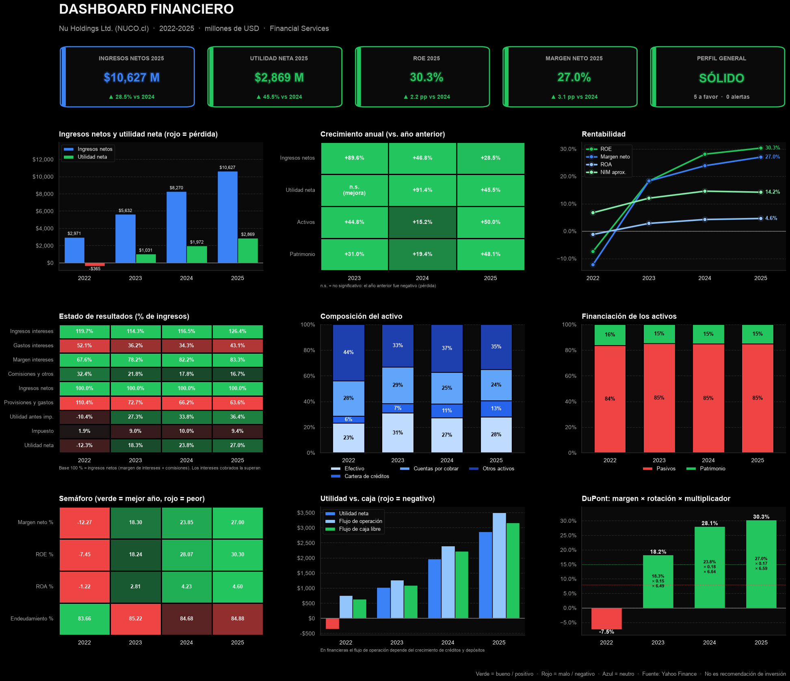

# Análisis de estados financieros con Python

Este notebook para analizar los estados financieros y los indicadores cada vez que quiero mirar una empresa. Ahora le doy un ticker y obtengo los tres estados ordenados como un informe con normas NIIF, los indicadores, una lectura de cómo está la empresa y un dashboard.

Los datos salen de Yahoo Finance con `yfinance`. Lo he usado sobre todo con acciones de la BVC, como Grupo Cibest y Nu.



## Cómo correrlo

```bash
pip install -r requirements.txt
```

Abre `analisis_estados_financieros.ipynb`, cambia el ticker en la primera celda y corre todo:

```python
ticker = "CIBEST.cl"   # BVC con .cl; para EE. UU. solo el símbolo: "AAPL", "NU"
año_inicio = 2022
año_fin = 2025
```

El dashboard queda guardado como `dashboard_<ticker>.png`.

## Qué hace

Primero baja el estado de resultados, el balance y el flujo de caja, y llena las cuentas que Yahoo deja vacías usando identidades contables (activo = pasivo + patrimonio, utilidad bruta = ingresos − costo, etc.). Siempre deja registro de qué datos calculó yo y cuáles venían de Yahoo.

Después calcula lo que normalmente miraría en un análisis:

- análisis horizontal y vertical;
- liquidez y endeudamiento;
- márgenes, ROE y ROA sobre saldos promedio, y DuPont;
- ciclo de efectivo y flujo de caja libre;
- múltiplos de mercado.

Con eso arma una interpretación por reglas, con alertas y lo que yo revisaría en cada caso. Los umbrales que usé son referencias generales, no verdades: siempre hay que comparar con empresas del mismo sector.


Por eso el notebook ahora separa los **problemas** (diferencias sin explicación, que hay que ir a buscar al informe oficial) de las **notas** (diferencias que ya tienen explicación). Los cuadres se hacen siempre con los datos originales de Yahoo, no con los que completé, para que un dato calculado no "cuadre" por construcción.

Es un proyecto de estudio: nada de lo que imprime es una recomendación de inversión.

