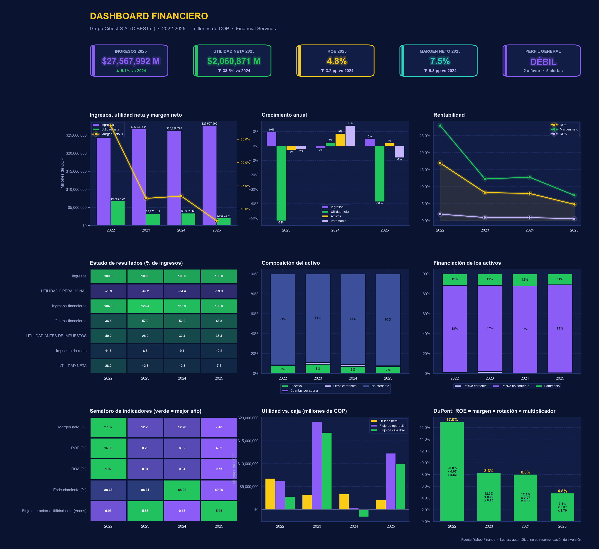

# 📊 Análisis de estados financieros con Python (NIIF + yfinance)

Descarga los estados financieros de cualquier empresa de Yahoo Finance, los organiza según las **NIIF**, calcula indicadores, escribe una **interpretación automática con alertas** y genera un **dashboard** y un **Excel**.

Solo hay que cambiar el ticker.



## ¿Por qué el código es largo?

Calcular los indicadores es lo fácil. La mayor parte del código se dedica a que los estados financieros queden **en orden NIIF y coherentes**, porque yfinance entrega las cuentas desordenadas, con nombres distintos según la empresa y con datos faltantes. Por eso el código:

- Organiza las cuentas en estado de resultados, balance y flujo de caja.
- Completa los datos faltantes con identidades contables (Activo = Pasivo + Patrimonio, etc.).
- Trata distinto a los bancos y fintech, que tienen otra estructura.
- Verifica que los estados cuadren entre sí.

> ⚠️ Funciona **solo con datos de yfinance**.

## ¿Qué incluye?

- Estados financieros en orden NIIF
- Análisis horizontal y vertical
- Indicadores de liquidez, endeudamiento, rentabilidad, eficiencia y DuPont
- Indicadores de mercado (P/E, P/B, EV/EBITDA, beta)
- Interpretación automática con alertas y recomendaciones
- Revisión de datos que no cuadran
- Dashboard con 9 gráficas y Excel con formato

## Uso

```bash
pip install yfinance pandas numpy matplotlib seaborn openpyxl
```

Abre `analisis_estados_financieros.ipynb` (o el script `analisis_estados_financieros.py`), cambia el ticker y ejecuta todo:

```python
ticker = "CIBEST.cl"
año_inicio = 2022
año_fin = 2025
```

Genera `analisis_<ticker>.xlsx` y `dashboard_<ticker>.png`.

## Limitaciones

- Solo datos de yfinance (normalmente los últimos 4 años).
- Los umbrales de la interpretación son generales; lo ideal es comparar con empresas del mismo sector.
- No es una recomendación de inversión.

## Autor

**Juan** — Ingeniero Financiero, Universidad de Medellín.
